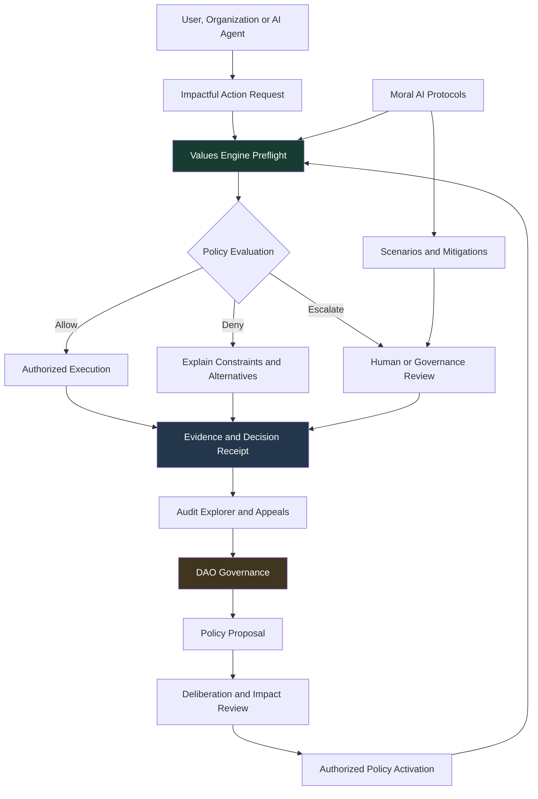
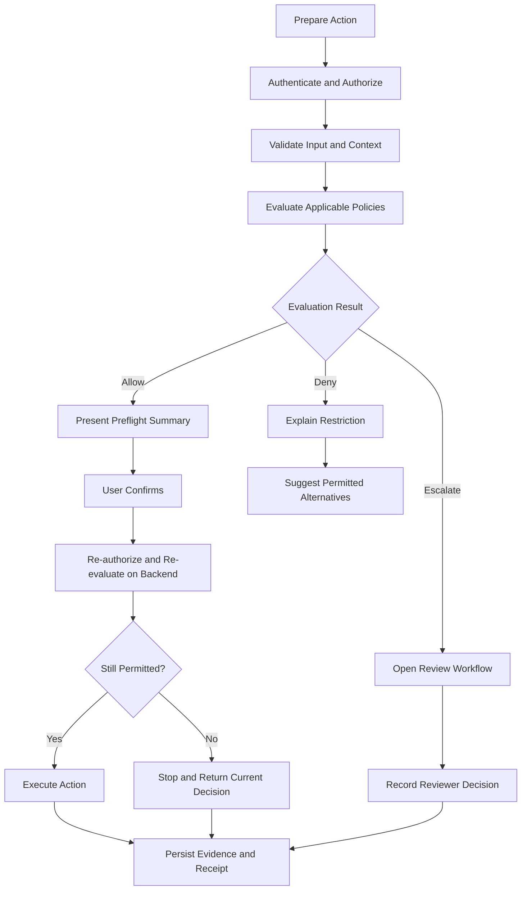

# Atlas Sanctum — Moral AI, Governance & Values Engine

### Building accountable intelligence through ethical constraints, transparent governance, and verifiable decisions.

<p align="center">
  <strong>AI proposes.</strong> · <strong>Policies constrain.</strong> · <strong>Governance arbitrates.</strong> · <strong>Evidence verifies.</strong>
</p>

---

## Overview

Atlas Sanctum is developing a collective intelligence and regenerative infrastructure platform designed to translate ethical principles into operational rules, accountable decisions, and measurable real-world outcomes.

The **Moral AI, Governance, and Values Engine** layer provides the accountability architecture that connects intelligent systems with the people, institutions, ecosystems, and communities affected by their decisions.

It addresses a fundamental challenge in AI-driven systems:

> How do we ensure that consequential decisions are not merely intelligent, but also constrained, explainable, contestable, and accountable?

Our approach rejects ethics as decorative language. Principles must translate into explicit policies, executable constraints, structured decision records, independent review, and meaningful recourse.

### Core architecture

| Component | Responsibility | Primary output |
|---|---|---|
| Moral AI Protocols | Advisory reasoning, scenario analysis, mitigation proposals, uncertainty disclosure | Structured recommendations |
| DAO Governance | Policy creation, collective deliberation, voting, oversight, and dispute resolution | Versioned, authorized policies |
| Values Engine | Deterministic policy evaluation and enforcement | Allow, deny, or escalate decisions |
| Evidence & Audit Layer | Immutable-by-design history, evidence references, policy versions, and decision receipts | Verifiable accountability records |
| Frontend Workspace | Human-readable explanations, decision review, appeals, and governance participation | Transparent and actionable experiences |

**Design principle:** AI can recommend an action, but it cannot grant itself authority. Binding constraints, legitimate authorization, and appropriate human oversight determine what the platform permits.

---

## Table of Contents

- [Vision and Design Principles](#vision-and-design-principles)
- [System Architecture](#system-architecture)
- [01 — Moral AI Protocols](#01--moral-ai-protocols)
- [02 — DAO Governance](#02--dao-governance)
- [03 — Values Engine](#03--values-engine)
- [04 — Decision Receipts and Auditability](#04--decision-receipts-and-auditability)
- [05 — Frontend Workspace](#05--frontend-workspace)
- [06 — Developer Experience](#06--developer-experience)
- [07 — Security and Anti-Corruption Design](#07--security-and-anti-corruption-design)
- [08 — Technical Architecture](#08--technical-architecture)
- [09 — Implementation Roadmap](#09--implementation-roadmap)
- [10 — Success Metrics](#10--success-metrics)
- [11 — Research and Limitations](#11--research-and-limitations)
- [Contributing](#contributing)
- [License](#license)

---

## Vision and Design Principles

Atlas Sanctum aims to help organizations turn complexity into trustworthy decisions, and decisions into measurable action.

The governance layer is founded on seven operational principles.

### 1. Preservation of Life

Systems with potential to affect human safety, health, housing, livelihood, or essential services must identify material risks and apply appropriate safeguards.

### 2. Stewardship

Resource allocation, environmental interventions, and digital infrastructure should account for long-term ecological consequences, resource constraints, and intergenerational responsibility.

### 3. Fairness and Inclusion

Decisions should be assessed for disparate impacts, exclusion, accessibility barriers, and the distribution of risks and benefits.

### 4. Transparency

Affected stakeholders should have access to meaningful explanations, relevant evidence, applicable policies, and available recourse, subject to legitimate privacy and security restrictions.

### 5. Accountability

Every consequential decision must identify the responsible system or authorized actor, the governing policy version, the evaluation outcome, and the appropriate review pathway.

### 6. Contestability

People and institutions must be able to challenge decisions, submit additional evidence, request reconsideration, and receive a traceable response.

### 7. Evidence-Based Reasoning

Claims about compliance and impact must distinguish observed evidence, modeled estimates, uncertainty, assumptions, and unverified assertions.

These principles are not self-executing. Their implementation requires explicit rules, thresholds, decision rights, responsible owners, and periodic review.

---

## System Architecture

The three central components form a continuous governance loop.



### The governing loop

**Values Engine → Moral AI → Governance → Policy update → Evaluation → Evidence → Learning**

- The Values Engine evaluates whether an action satisfies applicable constraints.
- Moral AI identifies trade-offs, generates alternatives, and communicates uncertainty.
- Governance establishes legitimate policy, resolves contested cases, and oversees exceptions.
- Evidence and audit records make decisions reviewable and help identify recurring failures.
- Approved policy changes feed back into the evaluation layer through controlled releases.

This separation prevents a single model, administrator, or interface from silently becoming the final authority over the entire system.

---

## 01 — Moral AI Protocols

### Purpose

Provide policy-constrained decision support without treating a model's output as unquestionable moral truth.

Moral AI is an advisory reasoning layer. It may analyze trade-offs, identify risks, compare scenarios, recommend mitigations, and explain competing interpretations of a policy.

It does not independently establish binding policy or bypass authorization requirements.

### Decision support contract

Every consequential AI-assisted recommendation should produce a structured record.

```typescript
type DecisionStatus =
  | "approved"
  | "denied"
  | "needs_review"
  | "escalated";

type ActorType =
  | "user"
  | "organization"
  | "agent"
  | "system";

interface DecisionRecord {
  decisionId: string;
  timestamp: string;

  actor: {
    id: string;
    type: ActorType;
  };

  actionType: string;
  status: DecisionStatus;

  policyVersion: string;
  evaluationId: string;

  principlesApplied: PrincipleReference[];
  constraintsTriggered: ConstraintReference[];

  riskAssessment: {
    riskScore?: number;
    scale?: string;
    harmEstimate?: number;
    uncertainty: string;
    assumptions: string[];
  };

  evidenceRefs: EvidenceReference[];
  counterfactuals: Counterfactual[];

  justification: StructuredJustification;
  appealRoute?: AppealRoute;
}
```

The interface should reject or flag incomplete records rather than manufacture missing audit information.

A model-generated explanation is not, by itself, proof that a decision complied with policy.

### Structured justification

```typescript
interface StructuredJustification {
  summary: string;
  findings: {
    statement: string;
    evidenceRefs: string[];
    confidence?: number;
    limitations?: string[];
  }[];

  satisfiedRequirements: string[];
  unmetRequirements: string[];
  assumptions: string[];
  unresolvedQuestions: string[];
}
```

Structured reasons make it possible to inspect the relationship between evidence, policies, findings, and outcomes without depending exclusively on free-form model-generated prose.

### Core frontend experiences

**Decision Receipt Panel**

A persistent view of what happened, why it happened, which policy applied, and what the user can do next.

**Principle Badges**

Human-readable references to applicable principles, supported by links to the actual policy definitions.

**Constraint Alerts**

Clear explanations when a condition blocks an action or requires further review.

**Explanation Modes**

- Citizen: concise explanations of consequences and available rights.
- Auditor: policy versions, evidence references, controls, and evaluation outcomes.
- Engineer: rule identifiers, evaluation traces, schema validation, and diagnostic information.

All modes must derive from the same underlying decision record. They must not invent different justifications.

**Counterfactual Analysis**

Explain which material assumptions or conditions could change an outcome. Counterfactuals must be identified as hypothetical, not guaranteed future results.

**Appeal Workflow**

Allow authorized users to challenge an outcome and append their claim, supporting evidence, and requested remedy to the original case.

### Uncertainty is part of the result

An AI-assisted decision should communicate:

- What is known and supported by evidence.
- What has been inferred or estimated.
- What relevant evidence is missing.
- Which assumptions materially affect the result.
- Whether uncertainty requires human review.

A confidence score alone must never be interpreted as a probability that a moral judgment is correct.

---

## 02 — DAO Governance

### Purpose

Make consequential policy decisions understandable, participatory, reviewable, and subject to defined institutional authority.

DAO governance provides a configurable mechanism for collective decision-making. Decentralization is not automatically equivalent to fairness: participation inequalities, concentrated voting power, identity fraud, and conflicts of interest must all be addressed.

The platform should support multiple governance arrangements, including community councils, institutional committees, elected representatives, and token-enabled voting where appropriate.

### Policy lifecycle

```mermaid
stateDiagram-v2
    [*] --> Draft
    Draft --> Proposed: Submit rationale
    Proposed --> Deliberation: Validate eligibility
    Deliberation --> Simulation: Assess consequences
    Simulation --> Voting: Review requirements satisfied
    Voting --> Approved: Quorum and threshold met
    Voting --> Rejected: Proposal fails
    Approved --> Scheduled: Authorized release
    Scheduled --> Active: Activate version
    Active --> Superseded: New version approved
    Active --> Suspended: Safety intervention
    Superseded --> [*]
    Suspended --> Deliberation: Review and remedy
    Rejected --> [*]
```



The activation pathway must also verify that a proposal was approved by the legally and operationally authorized decision-making body.

A successful vote does not override mandatory law, security controls, contractual obligations, or higher-priority safety constraints.

### Governance modules

| Module | Capabilities |
|---|---|
| Governance Home | Active proposals, policy versions, participation statistics, deadlines, and recent changes |
| Proposal Workspace | Plain-language rationale, supporting evidence, proposed policy changes, and identified conflicts |
| Policy Diff Viewer | Version-to-version comparison of rules, thresholds, permissions, and affected workflows |
| Impact Simulation | Scenario analysis, affected populations, risk distributions, assumptions, and limitations |
| Deliberation Space | Clause-specific comments, responses, evidence submissions, and documented objections |
| Voting Interface | Eligibility, quorum, thresholds, delegation, vote submission, and final tally |
| Treasury Oversight | Authorized budgets, disbursement conditions, milestone verification, and audit records |
| Dispute Resolution | Case intake, reviewer assignment, evidence, rulings, remedies, and escalation |
| Audit Explorer | Searchable policy, decision, and governance events with structured exports |

### Voting integrity

Every voting interface must make the following clear before a vote is submitted:

- Who is eligible to participate and why.
- Whether voting power is equal, delegated, weighted, or otherwise constrained.
- The quorum and approval threshold.
- Whether the vote is binding, advisory, or subject to further approval.
- How conflicts of interest are disclosed and managed.
- How results and subsequent actions will be audited.

The interface must not use preselected votes, hidden delegation, misleading countdowns, or manipulative defaults.

### Governance concentration

Where the voting model permits delegated or weighted participation, the platform should measure and disclose concentration risk.

Possible indicators include:

- Voting-power distribution.
- Delegation concentration.
- Voter participation and abstention.
- Proposal sponsorship concentration.
- Changes in control following delegation changes.
- Participation barriers across relevant stakeholder groups.

These metrics are diagnostic signals rather than proof of corruption or fairness.

### Emergency powers

Emergency interventions require explicit authorization boundaries:

1. A documented emergency basis.
2. A named authority or authorized automated trigger.
3. A limited scope of action.
4. An expiry or mandatory reauthorization.
5. A publicly reviewable audit record, subject to necessary security restrictions.
6. Independent review and a defined remedy where appropriate.

Emergency controls must not become a permanent bypass around democratic or institutional oversight.

---

## 03 — Values Engine

### Purpose

Evaluate impactful actions against explicit, versioned policies before execution and enforce those policies again at the trusted backend boundary.

The Values Engine is the operational control layer. It receives a proposed action and its context, evaluates applicable rules, identifies failures and conflicts, and returns a decision with a structured explanation.

Its architecture can draw on established policy-as-code systems such as Open Policy Agent (OPA), while keeping Atlas Sanctum's ethical principles, governance processes, and evidence contracts as an application-specific layer.

### Evaluation outcomes

```typescript
type EvaluationOutcome =
  | "allow"
  | "deny"
  | "escalate";

interface EvaluationRequest {
  requestId: string;

  actor: {
    id: string;
    type: ActorType;
    roles: string[];
  };

  action: {
    type: string;
    resourceId: string;
    parameters: Record<string, unknown>;
  };

  context: {
    organizationId: string;
    jurisdiction?: string;
    purpose: string;
    dataClassification?: string;
  };

  requestedPolicyVersion?: string;
}

interface EvaluationResponse {
  evaluationId: string;
  requestId: string;

  outcome: EvaluationOutcome;
  policyVersion: string;

  rulesEvaluated: string[];
  constraintsTriggered: ConstraintReference[];
  principlesApplied: PrincipleReference[];

  reasons: string[];
  missingEvidence: string[];

  alternatives: {
    description: string;
    changesRequired: string[];
  }[];

  reviewRequired: boolean;
  decisionTimestamp: string;
}
```

Production implementations should use validated schemas, controlled vocabularies, resource-specific permissions, and explicit rules for missing or conflicting inputs.

The generic `Record<string, unknown>` above is illustrative; production endpoints should define narrower, action-specific contracts.

### The ethics gate



### Non-negotiable enforcement rules

**The frontend is not the enforcement boundary.**

A browser can be modified, requests can be replayed, and client-side results can become stale. Consequently:

- Every consequential action must be authorized and evaluated by a trusted backend.
- Policies must be evaluated against the correct version and current context.
- A preflight approval must not automatically authorize later execution.
- Time-sensitive or high-risk requests must be rechecked immediately before execution.
- Evaluation failures must follow an explicit fail-closed, restricted-mode, or authorized emergency policy.
- No action may silently proceed merely because a policy service timed out.
- Receipts must distinguish a successful evaluation from successful execution.

Policy evaluation should be deterministic where the underlying rules and inputs are deterministic. Model-based risk estimates must remain identifiable as estimates, with their own uncertainty and validation requirements.

### Principles-to-rules mapping

Ethical commitments must translate into rules that can be tested.

| Principle | Example rule | Expected behavior |
|---|---|---|
| Preservation of Life | `LIFE.RISK_THRESHOLD_EXCEEDED` | Deny or escalate according to the approved safety policy |
| Fairness | `FAIRNESS.REQUIRED_ASSESSMENT_MISSING` | Require the missing assessment before proceeding |
| Stewardship | `STEWARDSHIP.RESOURCE_BUDGET_EXCEEDED` | Block or require an authorized exception |
| Privacy | `PRIVACY.PURPOSE_NOT_AUTHORIZED` | Deny unauthorized data use |
| Accountability | `ACCOUNTABILITY.RECEIPT_SCHEMA_INVALID` | Prevent execution until a valid audit record can be guaranteed |
| Contestability | `RECOURSE.REVIEW_ROUTE_UNAVAILABLE` | Prevent workflows from creating unreviewable consequential outcomes |

These identifiers are illustrative. The organization must define, validate, version, and test actual thresholds and rule semantics before deploying them.

### Safe alternatives

The Values Engine should do more than say no.

When appropriate, it should propose permitted alternatives, such as:

- Using aggregated rather than identifiable data.
- Reducing the scope of a requested data collection.
- Applying a shorter retention period.
- Requiring an independent assessment before proceeding.
- Reallocating resources to mitigate a documented risk.
- Routing a consequential decision to a qualified human reviewer.

Alternatives must be checked against the same applicable policy constraints rather than being treated as automatically safe.

---

## 04 — Decision Receipts and Auditability

### The receipt is the accountability artifact

An ethics receipt connects an action to its evaluation, execution result, applicable policies, evidence, and recourse options.

It is designed to answer five questions:

1. What happened?
2. Why was the action permitted, denied, or escalated?
3. Which policy version and evidence were used?
4. Who or what was responsible for the action?
5. How can the outcome be reviewed or challenged?

### Receipt contract

```typescript
interface EthicsReceipt {
  receiptId: string;
  schemaVersion: string;

  decisionId: string;
  evaluationId: string;
  issuedAt: string;

  policy: {
    policyId: string;
    version: string;
    effectiveAt: string;
  };

  action: {
    type: string;
    resourceId: string;
    executionStatus:
      | "completed"
      | "failed"
      | "blocked"
      | "pending_review";
  };

  evaluation: EvaluationResponse;

  evidenceRefs: EvidenceReference[];

  accountability: {
    responsibleActorId: string;
    reviewRequired: boolean;
    appealAvailable: boolean;
    appealRoute?: string;
  };

  integrity: {
    contentHash?: string;
    previousRecordHash?: string;
    signature?: string;
  };
}
```

A production schema should define exactly what is signed or hashed, which identity signs it, how keys are managed, and how the record is verified.

A hash or blockchain transaction alone does not prove that source evidence was true, that the policy was appropriate, or that the initial decision was fair.

### Audit requirements

Every relevant event should record, at minimum:

- Event identifier and timestamp.
- Authenticated actor or system identity.
- Action and affected resource.
- Evaluation identifier and applicable policy version.
- Outcome and machine-readable reason codes.
- Relevant evidence references.
- Execution result and any subsequent correction.
- Appeal, override, or reviewer disposition where applicable.

Sensitive information should be minimized, protected by access controls, and retained according to approved schedules. Public transparency does not require disclosing personal information or exploitable security details.

### Tamper evidence and data integrity

The platform may use append-only storage, access-controlled event streams, digital signatures, hashes, or external verification checkpoints to strengthen auditability.

Blockchain infrastructure should be introduced only where it provides a concrete advantage over conventional signed, access-controlled, auditable records.

The primary goal is reliable evidence, not indiscriminate on-chain storage.

### Export formats

Receipts should support machine-readable JSON and human-readable PDF exports, with stable identifiers and enough context to validate the record.

---

## 05 — Frontend Workspace

### Design objective

Create a collective workspace in which ethical constraints, institutional rules, AI recommendations, and governance actions become understandable to ordinary users and verifiable by specialists.

The interface should not require users to understand blockchain terminology, policy-engine internals, or AI model architecture to participate meaningfully.

### Workspace navigation

```text
Atlas Sanctum Workspace
│
├── Command Center
│   ├── Pending Decisions
│   ├── Policy Alerts
│   └── Governance Activity
│
├── Moral AI
│   ├── Decision Analysis
│   ├── Scenario Comparison
│   ├── Risk and Uncertainty
│   └── Suggested Mitigations
│
├── Values Engine
│   ├── Policy Evaluations
│   ├── Constraints and Rules
│   ├── Evaluation Simulator
│   └── Policy Versions
│
├── Governance
│   ├── Proposals
│   ├── Deliberation
│   ├── Voting
│   ├── Delegation
│   └── Treasury Oversight
│
├── Accountability
│   ├── Decision Receipts
│   ├── Audit Explorer
│   ├── Appeals and Disputes
│   └── Review Outcomes
│
└── Developer Tools
    ├── API and SDK Documentation
    ├── Test Policies
    ├── Evaluation Logs
    └── Integration Health
```

### Decision Receipt Panel

Every impactful action should expose a clear receipt view.

Recommended sections:

- **Outcome:** allowed, denied, or escalated.
- **Action:** what was requested and what was actually executed.
- **Rules:** which constraints were satisfied or triggered.
- **Evidence:** what was considered, what was unavailable, and what was excluded.
- **Uncertainty:** meaningful limitations and unresolved questions.
- **Policy:** the effective policy version and a link to its definition.
- **Recourse:** available appeal, reconsideration, or review options.

### UX states

All major modules must handle more than the successful path.

| State | UX expectation |
|---|---|
| Loading | Explain what is being evaluated without implying approval |
| Allowed | Display the outcome, applicable policy, and any material limitations |
| Denied | Provide a reason, relevant evidence, and permitted alternatives |
| Escalated | Identify the review stage, responsible authority, and next step |
| Unavailable | Explain the service failure and preserve safe execution boundaries |
| Stale evaluation | Require a fresh check when relevant inputs or policy versions change |
| Partial evidence | Disclose missing inputs and avoid unsupported conclusions |
| Appeal submitted | Provide a traceable case identifier and status |
| Policy changed | Show the new version and identify any affected workflow |

Accessibility, keyboard navigation, mobile responsiveness, localization, and plain-language explanations are core product requirements.

---

## 06 — Developer Experience

### Make responsible integration the default

Product teams should be able to integrate ethical policy checks as consistently as authentication, authorization, and structured logging.

The platform should provide shared contracts, typed SDKs, reusable UI components, local simulation, testing utilities, and deployment safeguards.

### Proposed SDK surface

```typescript
interface ValuesEngineClient {
  evaluate(
    request: EvaluationRequest
  ): Promise<EvaluationResponse>;

  getPolicyVersion(
    policyId: string
  ): Promise<string>;

  simulate(
    request: EvaluationRequest
  ): Promise<EvaluationResponse>;

  getReceipt(
    receiptId: string
  ): Promise<EthicsReceipt>;
}
```

The interface is illustrative rather than a claim that a published SDK already exists.

### Shared frontend components

| Component | Responsibility |
|---|---|
| `DecisionReceiptPanel` | Display a complete, traceable decision record |
| `PrincipleBadges` | Show applicable principles with links to their definitions |
| `ConstraintAlert` | Explain triggered rules and their consequences |
| `RiskAssessmentPanel` | Display assessed risks, assumptions, and uncertainty |
| `AppealModal` | Collect a challenge and supporting evidence |
| `PolicyDiffViewer` | Compare policy versions |
| `VotingPowerMap` | Visualize participation and delegation concentration |
| `EvaluationSimulator` | Test policy behavior using controlled scenarios |
| `EvidenceReferences` | Display source references and their verification status |

### Policy version pinning

Integrations should declare their expected policy compatibility and evaluate against an identifiable policy version.

For example:

```yaml
integration:
  name: regenerative-funding-workflow
  policy:
    id: capital-allocation
    minimum_version: "1.8.0"
    require_explicit_compatibility: true
```

This configuration is illustrative. Real deployments must define semantic compatibility rules, signature verification, migration procedures, and what happens when a required version is unavailable or withdrawn.

Version pinning must not silently preserve a policy that has been revoked for urgent safety or legal reasons.

### Testing toolkit

The developer experience should include:

- Schema validation and type-checking utilities.
- Mock policy responses for local development.
- Unit tests for individual constraints.
- Integration tests covering authorization and enforcement.
- Regression suites for policy changes.
- Adversarial and boundary-case testing.
- Replayable test cases with privacy-safe fixtures.
- Contract tests between frontend, policy service, and receipt storage.
- Failure-injection tests for timeouts, missing evidence, and unavailable services.

A policy release should not be considered production-ready until its required tests, approvals, migration checks, and rollback procedures have passed.

---

## 07 — Security and Anti-Corruption Design

### Security boundaries

Moral correctness and cybersecurity are separate requirements. A system can evaluate an ethical policy correctly while still leaking data or allowing unauthorized access.

Atlas Sanctum's governance layer should incorporate established security controls alongside its policy and accountability mechanisms.

**Identity and authorization**

- Authenticate users, services, and agents.
- Apply least-privilege permissions.
- Enforce tenant and resource boundaries on the backend.
- Separate proposal, approval, execution, and audit privileges where appropriate.
- Require stronger controls for sensitive or irreversible actions.

**Input and evidence integrity**

- Validate all inputs at trusted service boundaries.
- Record evidence provenance and verification status.
- Detect duplicate, stale, or inconsistent submissions.
- Treat user-supplied and model-generated content as untrusted input.
- Record meaningful changes to evidence and decisions.

**AI-specific protections**

- Treat model outputs as proposals, not executable authority.
- Protect against prompt injection and unauthorized tool invocation.
- Restrict agents to explicitly granted capabilities.
- Validate tool arguments and downstream permissions.
- Require confirmation or independent review where the action's impact warrants it.

**Operational resilience**

- Monitor evaluation latency, service failures, and policy drift.
- Establish tested recovery, incident-response, and revocation procedures.
- Preserve auditable failure states.
- Avoid automatic fallback to unrestricted execution.

### Governance integrity

The interface and backend should support:

- Disclosure and handling of conflicts of interest.
- Transparent voting eligibility and delegation rules.
- Measures that reduce participation barriers.
- Independent review of exceptional overrides.
- Separation of financial interests from compliance decisions.
- Public rationale and impact documentation where appropriate.
- Audit access for authorized independent reviewers.

Anti-corruption features should be enforceable through permissions, workflows, and verifiable records—not merely presented as voluntary interface conventions.

### Data protection

The platform must distinguish public governance records from sensitive information about affected people, operational infrastructure, and confidential investigations.

Apply data minimization, purpose limitation, retention controls, encryption, and auditable access policies. Provide appropriate redaction for public exports.

Privacy protection and transparency must be designed together rather than treated as competing afterthoughts.

---

## 08 — Technical Architecture

The following architecture is a proposed implementation blueprint, not a representation of an already deployed production system.

### Logical services

```text
Frontend Workspace
       │
       ▼
Authenticated API Gateway
       │
       ├── Identity and Authorization
       ├── Values Engine
       │      ├── Policy Registry
       │      ├── Rule Evaluation
       │      └── Simulation
       │
       ├── Moral AI Service
       │      ├── Scenario Analysis
       │      ├── Evidence Retrieval
       │      └── Uncertainty Reporting
       │
       ├── Governance Service
       │      ├── Proposals and Deliberation
       │      ├── Voting and Delegation
       │      └── Appeals and Review
       │
       ├── Decision and Receipt Service
       ├── Evidence Registry
       └── Audit Event Service
                    │
                    ▼
          Controlled Data Storage
```

### Suggested technology options

| Layer | Candidate technologies | Purpose |
|---|---|---|
| Frontend | React, TypeScript, Vite | Typed workspace and reusable components |
| API | TypeScript services or Go | Validated endpoints and workflow orchestration |
| Policy evaluation | Open Policy Agent or a custom constrained evaluator | Explicit, versioned policy decisions |
| Data storage | PostgreSQL | Decision records, policies, proposals, and case management |
| Event and audit layer | Append-only event records, signed artifacts, optional event streaming | Traceability and operational monitoring |
| Identity | OIDC-compatible identity provider and backend authorization | Authentication, roles, and scoped permissions |
| AI layer | Model adapters, retrieval services, structured output validation | Advisory reasoning and scenario analysis |
| Integration | REST or typed RPC, OpenAPI, shared schemas | Consistent service contracts |
| Optional decentralized infrastructure | Smart contracts and verifiable public attestations | Narrowly defined governance or registry use cases |

Technology choices should follow deployment constraints, threat modeling, costs, data residency, institutional requirements, and operational capacity.

Blockchain, DAO tooling, and autonomous agents are optional mechanisms. None is inherently required to implement reliable policy enforcement or accountability.

### Repository layout

```text
atlas-sanctum/
├── apps/
│   └── governance-workspace/
│       ├── src/
│       │   ├── components/
│       │   ├── features/
│       │   │   ├── moral-ai/
│       │   │   ├── values-engine/
│       │   │   ├── governance/
│       │   │   ├── receipts/
│       │   │   └── appeals/
│       │   ├── routes/
│       │   └── lib/
│       └── tests/
├── services/
│   ├── values-engine/
│   ├── moral-ai/
│   ├── governance/
│   ├── decision-records/
│   └── audit/
├── packages/
│   ├── contracts/
│   ├── values-sdk/
│   ├── ui/
│   └── policy-testing/
├── policies/
│   ├── life/
│   ├── fairness/
│   ├── stewardship/
│   ├── privacy/
│   └── accountability/
├── docs/
│   ├── architecture/
│   ├── governance/
│   ├── policy-reference/
│   ├── threat-model/
│   └── decision-records/
├── examples/
│   ├── data-sharing/
│   ├── funding-allocation/
│   └── impact-verification/
└── README.md
```

The layout can be adapted to an existing repository. It describes a potential modular monorepo, not mandatory deployment boundaries.

---

## 09 — Implementation Roadmap

Build a narrow, auditable system before attempting a universal ethics platform.

### Phase 1 — Contracts and enforcement foundation

**Objective:** Make a single consequential workflow explainable and enforceable.

Deliverables:

- Define the initial policy vocabulary and action types.
- Implement typed evaluation and receipt schemas.
- Build a versioned policy registry.
- Implement backend authorization and policy enforcement.
- Create allow, deny, and escalate response paths.
- Build the Decision Receipt Panel.
- Add tests for missing evidence, stale policies, and service failure.

**Acceptance criteria:** A protected action cannot complete without the required authorization and current policy evaluation. Each completed or blocked attempt has an associated traceable record or explicitly documented failure state.

### Phase 2 — Moral AI integration

**Objective:** Make model-assisted reasoning useful without allowing it to bypass policy.

Deliverables:

- Connect an advisory model through a constrained service boundary.
- Add structured recommendations and alternative scenarios.
- Display assumptions, missing evidence, and uncertainty.
- Validate model output against typed schemas.
- Require policy evaluation before consequential execution.
- Test prompt-injection and unauthorized-tool scenarios.

**Acceptance criteria:** Invalid, incomplete, or unauthorized model recommendations cannot bypass the trusted enforcement service. Human reviewers can distinguish model-generated assessments from verified facts.

### Phase 3 — Governance and appeals

**Objective:** Establish legitimate processes for changing policies and challenging decisions.

Deliverables:

- Proposal creation and structured rationale.
- Version comparison and impact-review interfaces.
- Voting eligibility, quorum, thresholds, and results.
- Appeal intake and reviewer assignment.
- Policy approval, activation, and rollback workflows.
- Conflict-of-interest and emergency-override controls.

**Acceptance criteria:** Every active policy has a traceable authorization history. Contested outcomes can be reviewed, and policy changes cannot become active outside the defined approval process.

### Phase 4 — Evidence and institutional integration

**Objective:** Make accountability interoperable across organizations and projects.

Deliverables:

- Evidence provenance and registry interfaces.
- Audit exploration and structured exports.
- External verification mechanisms where appropriate.
- SDK documentation and integration examples.
- Operational monitoring and incident reporting.
- Privacy, threat-model, and retention reviews.

**Acceptance criteria:** An authorized auditor can reconstruct a decision's action, applicable policy, evaluation outcome, supporting evidence references, and subsequent review history within the declared system boundaries.

### Phase 5 — Regenerative value and impact applications

**Objective:** Apply the governance infrastructure to real-world decisions.

Candidate use cases include:

- Climate adaptation funding.
- Ecosystem restoration and impact verification.
- Community infrastructure allocation.
- Responsible data sharing.
- Public-service resource prioritization.
- Regenerative finance and outcome-based funding.

Expansion should depend on demonstrated reliability, stakeholder legitimacy, legal review, and independently assessable outcomes.

---

## 10 — Success Metrics

Measure whether the system produces better accountability, not whether it merely generates more explanations or governance activity.

| Dimension | Example metric |
|---|---|
| Enforcement coverage | Percentage of designated consequential actions evaluated by trusted backend policies |
| Receipt completeness | Percentage of decisions with valid, required audit fields |
| Policy traceability | Percentage of decisions linked to an exact effective policy version |
| Reliability | Evaluation availability, latency, and documented failure rates |
| Decision quality | Error rates measured against independently adjudicated test cases |
| Contestability | Percentage of eligible decisions with a working review route |
| Appeals | Resolution time, reversal rate, and recurring failure categories |
| Governance legitimacy | Participation, delegation concentration, and representation gaps |
| Security | Unauthorized actions blocked and time to resolve verified security incidents |
| Impact integrity | Percentage of material outcome claims supported by appropriately verified evidence |
| Developer adoption | Integration completion, test coverage, and recurring evaluation failures |

Metrics must be interpreted in context. For example, a low appeal rate does not necessarily mean decisions are fair; it may indicate that affected people lack access to recourse.

Likewise, a high reversal rate may reflect better detection of errors rather than poor governance itself.

Metrics should be disaggregated only where lawful and appropriate, with privacy safeguards and sufficient statistical context.

---

## 11 — Research and Limitations

Atlas Sanctum treats ethical AI governance as an ongoing engineering and institutional research problem.

Important research areas include:

- Translating moral principles into explicit, testable policy constraints.
- Detecting conflicts between principles and applicable legal requirements.
- Calibrating model-generated risk estimates and communicating uncertainty.
- Measuring disparate impacts and identifying missing stakeholder representation.
- Designing accessible appeal mechanisms for AI-assisted decisions.
- Evaluating resistance to policy manipulation and governance capture.
- Verifying environmental and social outcomes without overstating causal attribution.
- Comparing centralized, federated, and decentralized governance approaches.
- Testing whether explanations actually improve understanding and meaningful contestability.

### What this architecture does not claim

The system does not establish a universal moral truth function, eliminate subjective judgment, guarantee unbiased outcomes, or automatically legitimize a DAO vote.

Policy evaluation is only as sound as the underlying rules, evidence, measurements, authority structure, and implementation.

Some decisions require professional judgment, affected-community participation, legal review, independent oversight, or a decision not to automate.

**The goal is not to automate conscience. It is to make consequential systems more constrained, transparent, reviewable, and accountable to the people they affect.**

---

## Contributing

Contributions are welcome in policy engineering, AI evaluation, governance research, accessible UX, security, evidence verification, and developer tooling.

Potential contribution areas:

- Typed decision and receipt contracts.
- Policy fixtures and regression tests.
- Reusable governance components.
- Accessibility and plain-language explanations.
- Adversarial testing and threat modeling.
- Evidence provenance and verification.
- Independent evaluation of policy effectiveness.
- Documentation for community and institutional reviewers.

### Contribution principles

1. Explain the problem and the affected stakeholders.
2. Identify the relevant policy or system boundary.
3. Include reproducible examples and tests.
4. Document uncertainty and known limitations.
5. Preserve reviewability and compatibility.
6. Never introduce a silent bypass of established safety or authorization controls.

Proposed policy changes should include a rationale, expected consequences, test cases, and a clear approval path.

---

## Our North Star

**Build systems that can explain what they do, justify what they permit, acknowledge what they do not know, and provide a legitimate path to challenge what they get wrong.**

Atlas Sanctum exists to help transform intelligence into trustworthy decisions, collective governance into accountable action, and ethical commitments into operational practice.

**AI proposes. Policies constrain. Governance arbitrates. Evidence verifies. Humanity remains accountable.**

---

*Atlas Sanctum — Regenerative Intelligence. Ethical Infrastructure. Shared Prosperity.*
